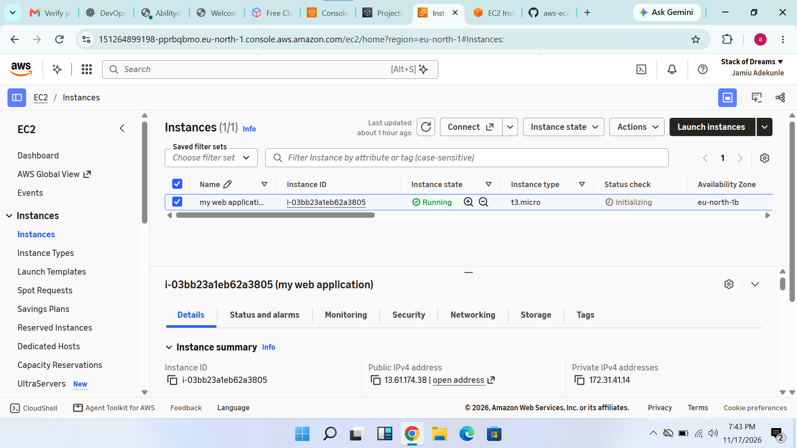
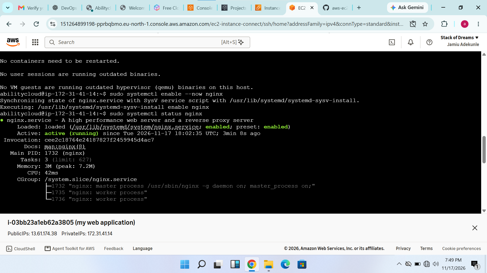
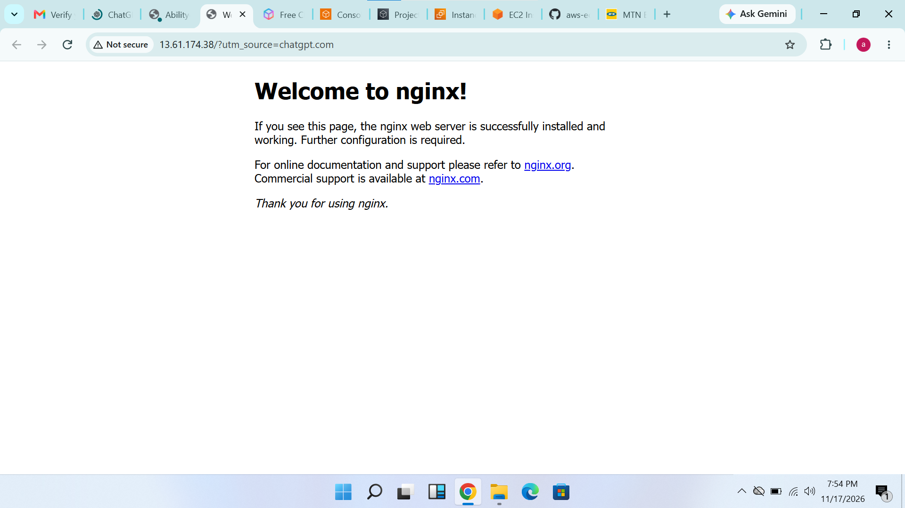
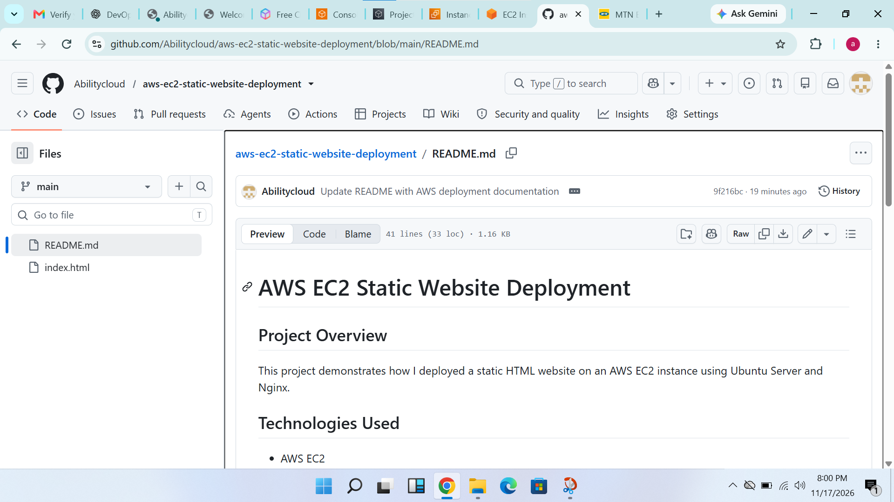

# AWS EC2 Deployment - Project Screenshots

These screenshots provide visual evidence of my AWS EC2 static website deployment.

## 1. EC2 Instance Running

## 2. Nginx Service Active

## 3. Live Website

## 4. GitHub Repository

